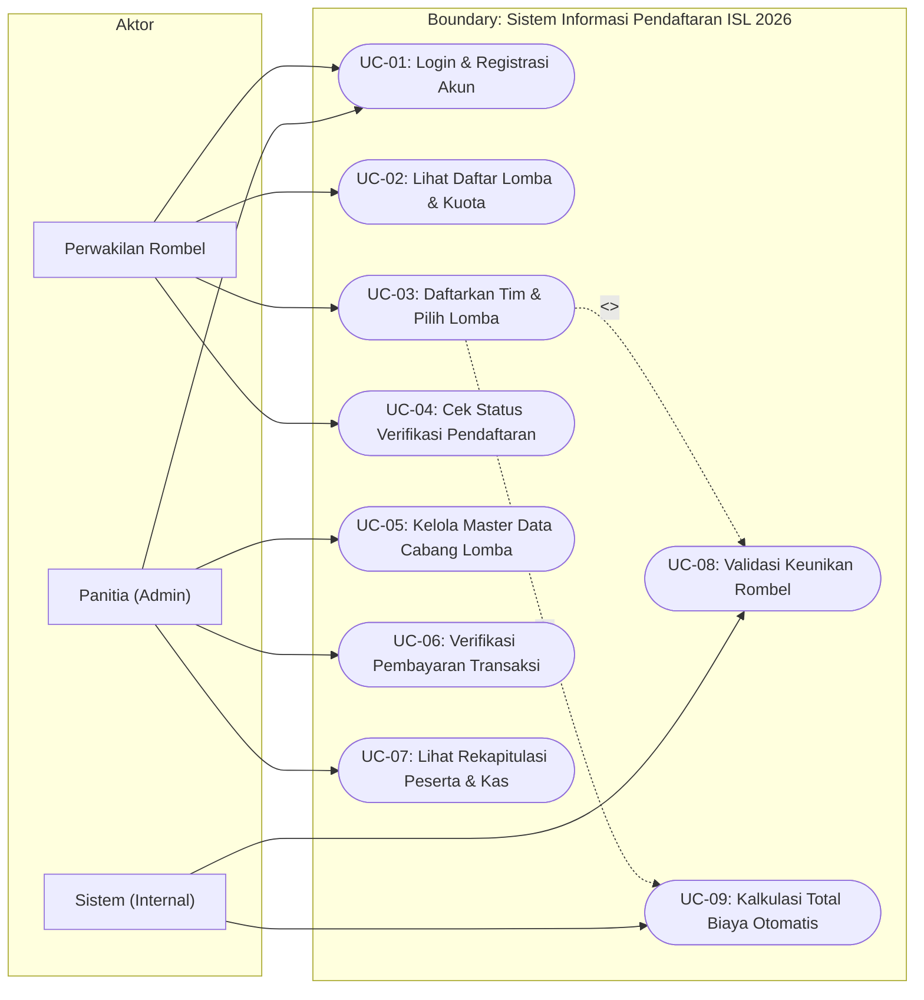
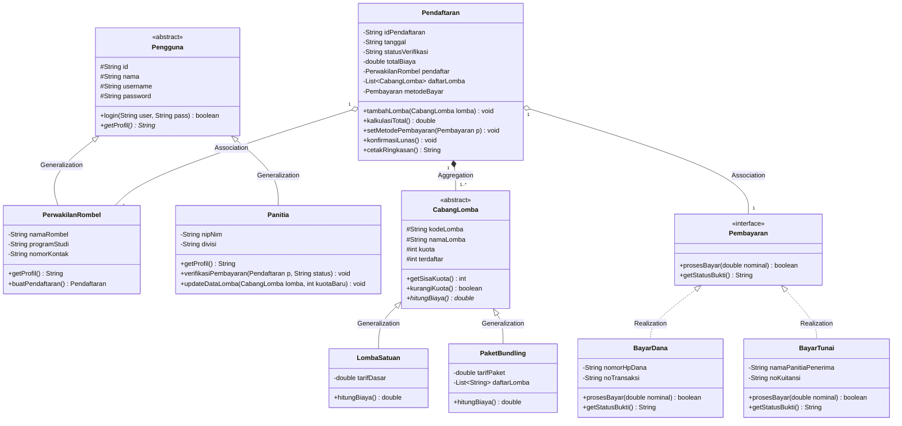

# PROPOSAL PROYEK SISTEM INFORMASI
## APLIKASI PENDAFTARAN INFORMATION SUPER LEAGUE (ISL) 2026 BERBASIS JAVA CLI

### IDENTITAS TIM & SAMPUL PROPOSAL

* **Mata Kuliah:** Praktikum Pemrograman Berorientasi Objek (PBO)
* **Program Studi:** S1 Teknologi Informasi – Universitas Tidar
* **Tahun Akademik:** 2026/2027
* **Nama Tim:** Hidup Bersama Jawa
* **Topik Proyek:** Sistem Informasi Pendaftaran Turnamen Information Super League (ISL) 2026

#### Susunan Anggota Tim & Pembagian Peran

| No | Nama Lengkap | NIM | Peran Utama | Tanggung Jawab Utama |
| :---: | :--- | :---: | :--- | :--- |
| 1 | **Muhammad Raka Mushaddaq** | 2505060072 | Project Advisor & Analyst | Pencetus ide, perumusan analisis kebutuhan, dan pengarah arsitektur sistem |
| 2 | **Sholahuddin Ahmad** | 2505060070 | Lead Developer | Perancangan Class Diagram, pengodean Core Class PBO, dan integrasi logika sistem |
| 3 | **Fachri Azizul Akbar** | 2505060077 | Technical Secretary | Penyusunan dokumentasi proposal, notulensi rapat, laporan teknis, dan administrasi tim |
| 4 | **Ahmad Zuhdan Sani** | 2340506069 | Tester & UI/UX Designer | Perancangan alur antarmuka CLI, validasi input konsol, dan pengujian keandalan sistem |

# BAB I. ANALISIS DAN RANCANGAN SISTEM

## 1. Latar Belakang

*Information Super League* (ISL) 2026 merupakan ajang kompetisi tahunan antar-rombongan belajar (rombel) di lingkungan Program Studi S1 Teknologi Informasi Universitas Tidar. Kegiatan ini mencakup beragam cabang perlombaan pada bidang olahraga fisik, *e-sports*, maupun kompetisi keahlian teknologi, yaitu: **Futsal, Badminton, Mobile Legends, PlayStation (PS), Hackathon, Capture The Flag (CTF), dan Crimping Kabel**. 

Mengingat tingginya antusiasme partisipasi mahasiswa dari berbagai angkatan serta diterapkannya dua skema biaya pendaftaran (pendaftaran cabang satuan maupun Paket *Bundling*), pengelolaan data transaksi pendaftaran secara akurat dan terpusat menjadi kebutuhan krusial bagi panitia pelaksana.

### Kondisi Saat Ini dan Bukti Pendukung:
Berdasarkan evaluasi pelaksanaan kepanitiaan periode sebelumnya, alur pendaftaran dan verifikasi pembayaran peserta masih berjalan secara semi-manual menggunakan borang survei daring (*Google Form*) yang terpisah dari lembar kerja rekapitulasi (*Google Sheets*). Pada sistem berjalan tersebut, perwakilan rombel harus mengisi formulir berulang kali jika mendaftar di lebih dari satu cabang lomba, serta mengunggah tangkapan layar bukti transfer secara manual.

Pendekatan semi-manual ini terbukti menimbulkan sejumlah kendala operasional nyata di lapangan, antara lain:
1. **Duplikasi Data Tim:** Terjadinya pendaftaran ganda oleh perwakilan rombel yang sama pada satu cabang lomba yang sama akibat tidak adanya sistem validasi keunikan entitas secara *real-time*, sehingga mengacaukan perhitungan sisa kuota lomba.
2. **Kesalahan Kalkulasi Biaya:** Perwakilan rombel maupun bendahara panitia kerap mengalami salah hitung selisih nominal pembayaran antara akumulasi lomba satuan dengan skema promo Paket *Bundling* (misal: tarif promo Rp250.000 untuk paket 3 cabang lomba).
3. **Keterlambatan Proses Verifikasi:** Panitia membutuhkan waktu verifikasi yang lama karena harus mencocokkan mutasi saldo (baik via transfer DANA maupun pembayaran tunai) dengan baris data *spreadsheet* satu demi satu.

Oleh karena itu, diperlukan sebuah aplikasi sistem informasi pendaftaran berbasis *Command Line Interface* (CLI) yang dibangun menggunakan bahasa pemrograman **Java (JDK 25)** dengan menerapkan paradigma **Pemrograman Berorientasi Objek (PBO)** secara murni guna mengotomatisasi validasi keunikan pendaftaran, kalkulasi biaya yang akurat, serta rekapitulasi data pendaftar yang terstruktur.

## 2. Identifikasi Masalah

### 2.1 Analisis 5 Whys
* **Gejala (Symptom):** Proses rekapitulasi data pendaftar, perhitungan tarif lomba, dan verifikasi status pembayaran peserta ISL 2026 berjalan lambat, rawan kesalahan input ganda rombel, dan merepotkan panitia.
* **Mengapa 1:** Panitia harus memeriksa data pendaftar dan mencocokkan nominal mutasi pembayaran (DANA/Tunai) secara manual satu per satu dari formulir terpisah.
* **Mengapa 2:** Media pengumpulan data (*Google Form*) tidak memiliki logika bisnis untuk menghitung tarif pendaftaran otomatis, membatasi kuota cabang secara otomatis, maupun mencegah input ganda.
* **Mengapa 3:** Data yang masuk hanya berupa baris pasif tanpa keterikatan model objek terstruktur yang menghubungkan entitas peserta, cabang lomba, dan metode pembayaran.
* **Mengapa 4:** Belum tersedianya aplikasi perangkat lunak terpusat berbasis Java yang mengimplementasikan konsep *Object-Oriented Programming* (enkapsulasi, pewarisan, polimorfisme, dan antarmuka) untuk memproses validasi pendaftaran dan transaksi secara terintegrasi.
* **Mengapa 5 (Akar Masalah):** Panitia mengandalkan alat survei umum serbaguna tanpa merancang sistem informasi pendaftaran khusus yang sesuai dengan domain aturan bisnis turnamen ISL 2026.

### 2.2 Problem Statement
> *"Masalah pengelolaan pendaftaran peserta, perhitungan biaya lomba, dan verifikasi pembayaran pada kegiatan Information Super League (ISL) 2026 saat ini masih dilakukan secara semi-manual menggunakan Google Form dan pengecekan spreadsheet. Hal ini berdampak langsung pada perwakilan rombel (kebingungan perhitungan tarif promo dan lamanya kepastian status) serta panitia pelaksana (rawan terjadi duplikasi rombel, selisih kas, dan lambatnya verifikasi mutasi). Solusi dinilai berhasil jika aplikasi sistem informasi berbasis Java CLI yang dibangun mampu memvalidasi keunikan rombel secara otomatis, mengkalkulasi tarif satuan dan paket bundling secara presisi, mengelola status verifikasi pembayaran, serta menyajikan rekapitulasi peserta per cabang lomba secara cepat dan terstruktur."*

## 3. Tujuan & Manfaat

### 3.1 Tujuan Proyek
Tujuan perancangan dan pembangunan sistem ini dirumuskan secara spesifik untuk masing-masing aktor:
1. **Bagi Perwakilan Rombel (Peserta):**
   * Menyediakan antarmuka pendaftaran berbasis konsol yang memandu pengisian data tim secara cepat dan terpadu.
   * Memberikan kejelasan kalkulasi rincian biaya pendaftaran secara otomatis (baik tarif satuan maupun Paket *Bundling*).
   * Memberikan transparansi status verifikasi transaksi pendaftaran (*Menunggu Verifikasi*, *Lunas*, atau *Ditolak*).
2. **Bagi Panitia Pelaksana (Admin):**
   * Mengotomatisasi validasi pencegahan pendaftaran ganda dari rombel yang sama pada cabang lomba yang sama.
   * Menyediakan menu pengelolaan kuota dan tarif cabang lomba secara dinamis.
   * Mempercepat proses verifikasi bukti bayar (DANA/Tunai) dan menghasilkan rekapitulasi pendaftar serta rekap total keuangan secara otomatis.
3. **Bagi Tim Pengembang (Akademik):**
   * Mengimplementasikan konsep dasar Pemrograman Berorientasi Objek (Enkapsulasi, Abstraksi, Pewarisan, dan Polimorfisme) serta perancangan diagram UML ke dalam perangkat lunak fungsional nyata.

### 3.2 Manfaat Proyek
1. **Manfaat Operasional:** Menghilangkan redudansi data, mencegah kelebihan kuota peserta, dan meniadakan potensi kerugian selisih kas akibat kesalahan perhitungan manual.
2. **Manfaat Waktu:** Memangkas durasi pendaftaran peserta dari rata-rata $\approx 10$ menit menjadi kurang dari 3 menit, serta mempercepat validasi panitia.
3. **Manfaat Akademis:** Menjadi artefak rekayasa perangkat lunak berbasis PBO yang dapat dikembangkan lebih lanjut pada mata kuliah lanjutan (seperti Pemrograman Visual atau Rekayasa Perangkat Lunak).

## 4. Ruang Lingkup

### 4.1 Fitur Dalam Cakupan (In-Scope)
1. **Otentikasi Pengguna Multi-Role:** Sistem login konsol untuk membedakan hak akses dan menu antara Panitia (Admin) dan Perwakilan Rombel.
2. **Katalog Cabang Lomba:** Menampilkan daftar cabang lomba resmi (Futsal, Badminton, MLBB, PS, Hackathon, CTF, Crimping Kabel) lengkap dengan sisa kuota dan tarif.
3. **Formulir Pendaftaran Tim:** Pendaftaran tim perwakilan rombel dengan validasi otomatis agar satu rombel tidak dapat mendaftar dua kali pada cabang lomba yang sama.
4. **Kalkulasi Biaya Otomatis (Polimorfisme Biaya):** Perhitungan total biaya pendaftaran berdasarkan skema lomba satuan maupun skema promo Paket *Bundling* (Rp250.000).
5. **Pemilihan Kanal Pembayaran (Interface):** Pemrosesan pembayaran melalui mekanisme transfer dompet digital (DANA) atau pembayaran tunai (Cash) ke panitia.
6. **Modul Verifikasi Pembayaran:** Panitia dapat meninjau daftar transaksi masuk dan mengubah status pendaftaran (*Menunggu Verifikasi*, *Lunas*, *Ditolak*).
7. **Laporan & Rekapitulasi Data:** Menampilkan rekapitulasi daftar peserta terdaftar per cabang lomba serta total penerimaan kas pendaftaran.

### 4.2 Fitur Luar Cakupan (Out-of-Scope)
1. **Integrasi Payment Gateway Otomatis:** Sistem tidak terhubung langsung dengan Webhook API perbankan/DANA secara *real-time* (panitia mengonfirmasi bukti bayar di aplikasi).
2. **Antarmuka Grafis (GUI) / Web / Mobile:** Sistem murni berbasis teks pada terminal/konsol (*Command Line Interface*).
3. **Manajemen Bagan Turnamen (Bracket & Scoring):** Pengacakan jadwal tanding, bagan gugur, dan pencatatan skor pertandingan tidak dicakup dalam sistem pendaftaran ini.

### 4.3 Batasan Sistem
1. **Bahasa & Lingkungan Eksekusi:** Aplikasi berjalan pada Java Development Kit versi 25 (JDK 25) melalui terminal konsol sistem operasi desktop (Linux/Windows/macOS).
2. **Penyimpanan Data (*In-Memory*):** Sesuai lingkup praktikum PBO dasar, seluruh data master dan transaksi disimpan sementara di memori kerja aplikasi menggunakan struktur data *Java Collections Framework* (`ArrayList` dan `HashMap`) tanpa DBMS eksternal.

## 5. Analisis Kebutuhan

### 5.1 Kebutuhan Fungsional (KF)

| Kode | Kebutuhan Fungsional (Sistem Harus Mampu...) | Aktor Terkait |
| :---: | :--- | :--- |
| **KF-01** | Menampilkan daftar seluruh cabang lomba yang tersedia beserta sisa kuota, deskripsi, dan skema tarifnya (satuan maupun Paket Bundling). | Perwakilan Rombel, Panitia |
| **KF-02** | Memfasilitasi perwakilan rombel untuk menginput identitas tim dan memilih satu atau beberapa cabang lomba yang ingin diikuti. | Perwakilan Rombel |
| **KF-03** | Memvalidasi keunikan rombel secara otomatis untuk menolak pendaftaran jika rombel tersebut sudah terdaftar pada cabang lomba yang dipilih. | Sistem |
| **KF-04** | Menghitung total tagihan pendaftaran secara otomatis berdasarkan jenis skema tarif cabang lomba yang dipilih (Lomba Satuan atau Paket Bundling). | Sistem |
| **KF-05** | Memproses pemilihan metode pembayaran (Transfer DANA atau Tunai) dan mencatat referensi/nomor transaksi pembayaran sebelum diajukan. | Perwakilan Rombel |
| **KF-06** | Menyediakan fitur bagi panitia untuk memeriksa transaksi yang masuk dan memperbarui status verifikasi pembayaran (*Lunas* / *Ditolak*). | Panitia |
| **KF-07** | Memungkinkan panitia memperbarui data master lomba (menambah kuota atau menyesuaikan tarif lomba). | Panitia |
| **KF-08** | Menampilkan rekapitulasi data tim peserta yang telah terdaftar per cabang lomba dan akumulasi pemasukan biaya pendaftaran yang berstatus lunas. | Panitia |

### 5.2 Kebutuhan Non-Fungsional (KNF)

| Kode | Parameter / Kategori | Kebutuhan Non-Fungsional (Spesifikasi Terukur) |
| :---: | :--- | :--- |
| **KNF-01** | *Usability* (Kemudahan) | Menu berbasis konsol CLI harus dirancang hierarkis dan informatif dengan pesan kesalahan (*error message*) yang jelas jika terjadi kegagalan input, sehingga pengguna dapat menyelesaikan alur pendaftaran dalam waktu $< 3$ menit. |
| **KNF-02** | *Performance* (Kecepatan) | Seluruh operasi pemrosesan logika bisnis, validasi duplikasi rombel, dan kalkulasi tarif di dalam memori (*in-memory*) harus merespons dalam waktu $< 1$ detik. |
| **KNF-03** | *Security & Access Control* | Hak akses menu pengelolaan lomba, verifikasi transaksi kas, dan rekapitulasi dibatasi secara ketat hanya dapat diakses oleh Panitia yang berhasil diautentikasi dengan kredensial yang valid. |

## 6. Aktor & Use Case

### 6.1 Tabel Pemetaan Aktor dan Tujuan

| Aktor | Peran & Deskripsi Singkat | Tujuan Utama (*Goal*) | Use Case Terkait |
| :--- | :--- | :--- | :--- |
| **Perwakilan Rombel** | Mahasiswa yang mewakili rombongan belajar untuk mendaftarkan timnya pada ISL 2026. | 1. Melihat informasi lomba & kuota 2. Mendaftarkan tim rombel 3. Memilih pembayaran & melunasi biaya 4. Memantau status pendaftaran | UC-01, UC-02, UC-03, UC-04 |
| **Panitia (Admin)** | Panitia pelaksana divisi pendaftaran dan kesekretariatan ISL 2026. | 1. Mengelola kuota & data lomba 2. Memvalidasi transaksi pembayaran 3. Melihat laporan rekap pendaftar & keuangan | UC-01, UC-05, UC-06, UC-07 |
| **Sistem** | Logika internal aplikasi berbasis Java PBO. | 1. Memvalidasi keunikan rombel 2. Menghitung tarif secara polimorfik | UC-08, UC-09 |

### 6.2 Diagram Use Case

### 6.3 Deskripsi Singkat Use Case
* **UC-01 (Login & Registrasi Akun):** Memverifikasi identitas pengguna berdasarkan *username* dan *password* untuk mengarahkan pengguna ke menu yang sesuai dengan perannya.
* **UC-02 (Lihat Daftar Lomba & Kuota):** Menampilkan rincian seluruh cabang lomba, tarif, dan ketersediaan kuota slot pendaftaran.
* **UC-03 (Daftarkan Tim & Pilih Lomba):** Perwakilan rombel menginput identitas tim, memilih cabang lomba satuan atau paket bundling, serta memilih kanal pembayaran.
* **UC-04 (Cek Status Verifikasi Pendaftaran):** Menampilkan status transaksi pendaftaran apakah *Menunggu Verifikasi*, *Lunas*, atau *Ditolak*.
* **UC-05 (Kelola Master Data Cabang Lomba):** Panitia memperbarui informasi batas kuota peserta dan tarif cabang lomba.
* **UC-06 (Verifikasi Pembayaran Transaksi):** Panitia meninjau referensi bukti pembayaran yang diinput rombel dan mengubah status pendaftaran menjadi Lunas atau Ditolak.
* **UC-07 (Lihat Rekapitulasi Peserta & Kas):** Panitia mencetak rekap data tim peserta per cabang lomba dan total dana pendaftaran yang telah diverifikasi lunas.
* **UC-08 (Validasi Keunikan Rombel):** Sistem internal melakukan pemeriksaan apakah rombel sudah terdaftar pada cabang lomba yang bersangkutan sebelum transaksi disimpan.
* **UC-09 (Kalkulasi Total Biaya Otomatis):** Sistem menghitung tarif secara dinamis berdasarkan jenis objek cabang lomba yang dipilih (apakah `LombaSatuan` atau `PaketBundling`).

## 7. Objek & Kelas

### 7.1 Analisis Kata Benda dan Kata Kerja (Abbott Method)
Berdasarkan narasi domain pendaftaran ISL 2026, dilakukan ekstraksi elemen bahasa untuk menentukan kandidat kelas, atribut, dan perilaku (*method*):

* **Kata Benda (Kandidat Kelas & Atribut):**
  Pengguna, Perwakilan Rombel, Panitia, Cabang Lomba, Lomba Satuan, Paket Bundling, Pembayaran, Bayar DANA, Bayar Tunai, Pendaftaran, id pengguna, nama, username, password, nama rombel, program studi, nomor kontak, kode lomba, nama lomba, kuota lomba, tarif dasar, total biaya, tanggal daftar, status verifikasi, nomor referensi transaksi.
* **Kata Kerja (Kandidat Method / Behavior):**
  login(), logout(), getProfil(), buatPendaftaran(), verifikasiPembayaran(), updateDataLomba(), kurangiKuota(), hitungBiaya(), prosesBayar(), getStatusBukti(), tambahLomba(), kalkulasiTotal(), konfirmasiLunas().

### 7.2 Tabel Seleksi Kandidat Kelas

| No | Kandidat Kelas / Interface | Jenis Komponen PBO | Status Keputusan | Alasan Pemilihan & Penerapan Konsep PBO |
| :---: | :--- | :--- | :---: | :--- |
| 1 | **Pengguna** | *Abstract Class* | **Dipilih** | Menerapkan konsep **Abstraksi & Pewarisan**. Menjadi *superclass* yang mengenkapsulasi atribut bersama (`id`, `nama`, `username`, `password`) dan metode umum `login()`. |
| 2 | **PerwakilanRombel** | *Concrete Class* | **Dipilih** | Turunan dari `Pengguna` (*Inheritance*). Menambahkan atribut spesifik rombel (`namaRombel`, `prodi`, `kontak`) dan aksi membuat pendaftaran. |
| 3 | **Panitia** | *Concrete Class* | **Dipilih** | Turunan dari `Pengguna` (*Inheritance*). Menambahkan atribut `divisi` serta wewenang verifikasi bayar dan pembaruan data lomba. |
| 4 | **CabangLomba** | *Abstract Class* | **Dipilih** | Menerapkan konsep **Abstraksi & Polimorfisme**. Mendefinisikan atribut umum lomba (`kodeLomba`, `namaLomba`, `kuota`) dan metode abstrak `hitungBiaya()`. |
| 5 | **LombaSatuan** | *Concrete Class* | **Dipilih** | Turunan dari `CabangLomba`. Mengimplementasikan perhitungan biaya tarif tunggal standar per perlombaan. |
| 6 | **PaketBundling** | *Concrete Class* | **Dipilih** | Turunan dari `CabangLomba`. Mengimplementasikan perhitungan biaya promo paket kombinasi lomba (Rp250.000). |
| 7 | **Pembayaran** | *Interface* | **Dipilih** | Menerapkan konsep **Abstraksi / Interface**. Mendefinisikan kontrak operasi pembayaran `prosesBayar(double nominal)` dan `getStatusBukti()`. |
| 8 | **BayarDana** | *Concrete Class* | **Dipilih** | Mengimplementasikan interface `Pembayaran` untuk kanal transfer dompet digital DANA beserta nomor transaksi. |
| 9 | **BayarTunai** | *Concrete Class* | **Dipilih** | Mengimplementasikan interface `Pembayaran` untuk kanal bayar langsung ke panitia dengan bukti kuitansi. |
| 10 | **Pendaftaran** | *Concrete Class* | **Dipilih** | Kelas transaksi utama yang mengagregasikan data peserta (`PerwakilanRombel`), daftar perlombaan (`CabangLomba`), dan mekanisme `Pembayaran`. |

### 7.3 Kartu CRC (Class-Responsibility-Collaborator)

Berikut adalah 6 Kartu CRC mandiri yang merepresentasikan pemisahan tanggung jawab (*Single Responsibility Principle*) dan kolaborasi antarentitas:

#### 1. Kartu CRC: Pengguna (Abstract)
* **Class Name:** `Pengguna` (Abstract Superclass)
* **Superclass / Subclass:** Induk dari `PerwakilanRombel` dan `Panitia`
* **Responsibilities (Tanggung Jawab):**
  * Menyimpan identitas otentikasi dasar (`id`, `nama`, `username`, `password`).
  * Memvalidasi kredensial login pengguna.
  * Mendefinisikan kontrak method abstrak `getProfil()` untuk diimplementasikan subkelas.
* **Collaborators (Kolaborator):**
  * `PerwakilanRombel`
  * `Panitia`

#### 2. Kartu CRC: PerwakilanRombel
* **Class Name:** `PerwakilanRombel` (Concrete Class)
* **Superclass / Subclass:** Turunan dari `Pengguna`
* **Responsibilities (Tanggung Jawab):**
  * Menyimpan atribut rombel (`namaRombel`, `programStudi`, `nomorKontak`).
  * Mengoverride method `getProfil()` untuk menampilkan identitas rombel.
  * Melakukan inisialisasi pembuatan objek transaksi `Pendaftaran`.
* **Collaborators (Kolaborator):**
  * `Pengguna`
  * `Pendaftaran`

#### 3. Kartu CRC: Panitia
* **Class Name:** `Panitia` (Concrete Class)
* **Superclass / Subclass:** Turunan dari `Pengguna`
* **Responsibilities (Tanggung Jawab):**
  * Menyimpan identitas panitia (`nipNim`, `divisi`).
  * Memvalidasi dan mengubah status pembayaran pada objek `Pendaftaran`.
  * Memperbarui kuota dan data master pada objek `CabangLomba`.
* **Collaborators (Kolaborator):**
  * `Pengguna`
  * `Pendaftaran`
  * `CabangLomba`

#### 4. Kartu CRC: CabangLomba & Subkelas (LombaSatuan, PaketBundling)
* **Class Name:** `CabangLomba` (Abstract) beserta `LombaSatuan` & `PaketBundling`
* **Superclass / Subclass:** Induk bagi `LombaSatuan` dan `PaketBundling`
* **Responsibilities (Tanggung Jawab):**
  * Menyimpan informasi master lomba (`kodeLomba`, `namaLomba`, `kuota`, `terdaftar`).
  * Memeriksa ketersediaan slot dan mengurangi kuota lomba (`kurangiKuota()`).
  * Menghitung nilai tarif secara polimorfik melalui method `hitungBiaya()`.
* **Collaborators (Kolaborator):**
  * `Pendaftaran`
  * `Panitia`

#### 5. Kartu CRC: Pembayaran (Interface) & Subkelas (BayarDana, BayarTunai)
* **Class Name:** `Pembayaran` (Interface) beserta `BayarDana` & `BayarTunai`
* **Superclass / Subclass:** Kontrak interface bagi kanal pembayaran konkret
* **Responsibilities (Tanggung Jawab):**
  * Mendefinisikan kontrak method transaksi `prosesBayar(double nominal)`.
  * Mengembalikan keterangan bukti pembayaran melalui `getStatusBukti()`.
  * Menyimpan data spesifik metode (nomor telepon DANA atau nama panitia penerima tunai).
* **Collaborators (Kolaborator):**
  * `Pendaftaran`

#### 6. Kartu CRC: Pendaftaran
* **Class Name:** `Pendaftaran` (Concrete Class)
* **Superclass / Subclass:** -
* **Responsibilities (Tanggung Jawab):**
  * Mengelola identitas transaksi (`idPendaftaran`, `tanggal`, `statusVerifikasi`).
  * Menyimpan relasi peserta pendaftar (`PerwakilanRombel`).
  * Menghimpun daftar lomba yang dipilih dan mengakumulasi `totalBiaya`.
  * Mengikat metode pembayaran yang dipilih (`Pembayaran`) dan mengonfirmasi pelunasan.
* **Collaborators (Kolaborator):**
  * `PerwakilanRombel`
  * `CabangLomba`
  * `Pembayaran`

## 8. Draf Class Diagram

Rancangan kelas mengimplementasikan seluruh pilar PBO: **Abstraksi**, **Enkapsulasi**, **Pewarisan** (Inheritance pada `Pengguna` dan `CabangLomba`), serta **Realisasi Interface & Polimorfisme** (pada `Pembayaran`).

### 8.1 Visualisasi Class Diagram (Mermaid)

### 8.2 Rincian Spesifikasi Kelas & Relasi

1. **Superclass Abstrak `Pengguna`:**
   * **Atribut:** `id` (protected), `nama` (protected), `username` (protected), `password` (protected).
   * **Method:** `+login(String user, String pass): boolean`, `+getProfil(): String` (abstract).
2. **Subclass `PerwakilanRombel` (Inheritance):**
   * **Atribut:** `namaRombel` (private), `programStudi` (private), `nomorKontak` (private).
   * **Method:** `+getProfil(): String` (override), `+buatPendaftaran(): Pendaftaran`.
3. **Subclass `Panitia` (Inheritance):**
   * **Atribut:** `nipNim` (private), `divisi` (private).
   * **Method:** `+getProfil(): String` (override), `+verifikasiPembayaran(Pendaftaran, String): void`, `+updateDataLomba(CabangLomba, int): void`.
4. **Superclass Abstrak `CabangLomba`:**
   * **Atribut:** `kodeLomba` (protected), `namaLomba` (protected), `kuota` (protected), `terdaftar` (protected).
   * **Method:** `+getSisaKuota(): int`, `+kurangiKuota(): boolean`, `+hitungBiaya(): double` (abstract).
5. **Subclass `LombaSatuan` & `PaketBundling` (Polimorfisme Perhitungan Biaya):**
   * `LombaSatuan`: Memiliki `tarifDasar` dan mengembalikan nilai biaya standar lomba.
   * `PaketBundling`: Memiliki `tarifPaket` promo tetap (Rp250.000) untuk kombinasi cabang lomba yang didaftarkan.
6. **Interface `Pembayaran` & Subclass Konkret:**
   * Interface mendefinisikan kontrak: `+prosesBayar(double): boolean` dan `+getStatusBukti(): String`.
   * `BayarDana`: Mengelola validasi nomor akun DANA dan kode referensi transfer.
   * `BayarTunai`: Mengelola validasi nomor kuitansi fisik dan nama panitia penerima.
7. **Class Transaksi `Pendaftaran`:**
   * Berperan sebagai pusat agregasi yang menghubungkan 1 objek `PerwakilanRombel`, 1 atau lebih objek `CabangLomba`, serta 1 objek implementasi `Pembayaran`.

## 9. Rencana Teknis

Rencana teknis implementasi proyek mencakup spesifikasi perangkat lunak, pustaka, dan lingkungan kolaborasi:

* **Bahasa Pemrograman:** Java Standard Edition (JDK 25).
* **Paradigma Pemrograman:** Pure Object-Oriented Programming (OOP) menerapkan Enkapsulasi, Abstraksi, Pewarisan, Polimorfisme, dan Interface.
* **Integrated Development Environment (IDE):** IntelliJ IDEA 2024 / 2025.
* **Tipe Antarmuka (*User Interface*):** Command Line Interface (CLI) / Konsol berbasis teks dengan pembacaan input via `java.util.Scanner`.
* **Arsitektur Penyimpanan (*Storage*):** Prototipe *In-Memory Data Structures* menggunakan Java Collections Framework (`ArrayList<T>` untuk daftar transaksi/lomba dan `HashMap<K, V>` untuk manajemen akun pendaftar).
* **Repositori GitHub & Kolaborasi Tim:**
  * **URL Repositori Resmi:** [https://github.com/McWooden/praktikum-object-oriented-programming.git](https://github.com/McWooden/praktikum-object-oriented-programming.git)
  * **Alur Kerja Git:** *Feature-branch workflow* (setiap anggota membuat *branch* fitur sebelum digabungkan ke cabang utama `main`).

## 10. Jadwal & Peran (Gantt Chart Semester)

Proyek ini dilaksanakan secara intensif mulai dari **Pertemuan ke-9 (10 November 2026)** hingga **Pertemuan ke-15 (22 Desember 2026)** menjelang masa Evaluasi Akhir Semester (UAS).

### 10.1 Matriks Gantt Chart Mingguan (Pertemuan 9 s.d. 15)

| No | Tahapan Kegiatan Proyek | Penanggung Jawab | P9 (10 Nov) | P10 (17 Nov) | P11 (24 Nov) | P12 (01 Des) | P13 (08 Des) | P14 (15 Des) | P15 (22 Des) |
| :---: | :--- | :--- | :---: | :---: | :---: | :---: | :---: | :---: | :---: |
| 1 | **Analisis Kebutuhan & Penyusunan Proposal (LK 1)** Identifikasi 5 Whys, Problem Statement, & Scope | M. Raka Mushaddaq & Fachri Azizul | **[XXXX]** | | | | | | |
| 2 | **Perancangan OOP & Pemodelan Diagram** Ekstraksi kata benda, tabel seleksi, CRC, & Class Diagram | Sholahuddin Ahmad & Ahmad Zuhdan | | **[XXXX]** | | | | | |
| 3 | **Implementasi Core Class Model PBO** Pengodean `Pengguna`, `CabangLomba`, `Pembayaran`, dsb. | Sholahuddin Ahmad | | | **[XXXX]** | | | | |
| 4 | **Pengodean Logika Bisnis & Menu CLI Konsol** Alur pendaftaran, validasi duplikasi, & kalkulasi biaya | Sholahuddin Ahmad & Ahmad Zuhdan | | | | **[XXXX]** | | | |
| 5 | **Pengujian Sistem (Testing) & Penanganan Bug** Black-box testing alur pendaftaran CLI & validasi input | Ahmad Zuhdan Sani | | | | | **[XXXX]** | | |
| 6 | **Finalisasi Dokumentasi & Repositori GitHub** Penyusunan laporan akhir, notulen, & *code refactoring* | Fachri Azizul & M. Raka | | | | | | **[XXXX]** | |
| 7 | **Presentasi & Demo Aplikasi Proyek Akhir (UAS)** Demonstrasi sistem pendaftaran ISL 2026 di depan dosen/asisten | Seluruh Anggota Tim | | | | | | | **[XXXX]** |

# LAMPIRAN-LAMPIRAN

## LAMPIRAN 1: TEAM CHARTER & LEMBAR KOMITMEN BERSAMA

### 1. Tujuan dan Nilai Bersama Tim
Tim **Hidup Bersama Jawa** bersepakat untuk:
* Mengembangkan aplikasi pendaftaran ISL 2026 secara bertanggung jawab, tepat waktu, dan menjunjung tinggi integritas akademik tanpa plagiasi kode.
* Mengutamakan komunikasi yang terbuka, jujur, dan solutif dalam mengatasi kendala teknis maupun non-teknis.

### 2. Aturan Komunikasi dan Pertemuan
* **Kanal Utama Komunikasi:** Grup WhatsApp Tim & Discord untuk sesi koordinasi suara / *screen-sharing* pengodean.
* **Pertemuan Rutin Mingguan:** Diadakan setiap hari Selasa setelah sesi perkuliahan Praktikum PBO untuk sinkronisasi progres (*standup meeting* $\pm 30$ menit).
* **Toleransi Keterlambatan Tugas:** Maksimal 1x24 jam dari tenggat internal dengan pemberitahuan sebelumnya kepada Project Advisor/Koordinator.

### 3. Prosedur Resolusi Konflik
1. Kendala diselesaikan secara musyawarah kekeluargaan antar-anggota yang bersangkutan.
2. Jika tidak tercapai kesepakatan, Project Advisor (Muhammad Raka Mushaddaq) bertindak sebagai mediator pemutus keputusan akhir.
3. Seluruh keputusan teknis arsitektur kode mengacu pada kesepakatan desain Class Diagram yang telah disetujui bersama.

### 4. Pernyataan Komitmen Anggota Tim

Seluruh anggota tim (Muhammad Raka Mushaddaq, Sholahuddin Ahmad, Fachri Azizul Akbar, dan Ahmad Zuhdan Sani) menyatakan telah menyetujui seluruh ketentuan dalam Team Charter ini dan berkomitmen penuh untuk berkontribusi aktif sesuai peran serta tanggung jawab masing-masing.

## LAMPIRAN 2: NOTULEN RAPAT KOORDINASI TIM

### Notulensi Rapat 01: *Kick-Off* Proyek & Perumusan Ide Proposal
* **Hari / Tanggal:** Selasa, 10 November 2026
* **Waktu:** 15.30 – 17.00 WIB
* **Tempat:** Ruang Diskusi Gedung Kuliah Terpadu / Discord
* **Agenda Rapat:**
  1. Pembagian peran dan tanggung jawab anggota tim *Hidup Bersama Jawa*.
  2. Brainstorming topik proyek akhir praktikum PBO.
  3. Analisis masalah nyata pendaftaran turnamen *Information Super League* (ISL) 2026.
  4. Penyusunan draf awal Lembar Kerja 1 (LK 1) / Proposal Proyek.

#### Poin Pembahasan & Keputusan:
1. **Penetapan Topik:** Disepakati secara bulat mengangkat sistem pendaftaran turnamen ISL 2026 karena kepanitiaan sebelumnya mengalami kendala duplikasi pendaftaran di Google Form dan kesulitan menghitung paket bundling.
2. **Penetapan Lingkup Batasan:** Sistem dibatasi berbasis Command Line Interface (CLI) menggunakan Java JDK 25 dengan *in-memory collection* agar tim fokus mendalami konsep murni PBO (inheritance, polymorphism, interface) tanpa terbebani kerumitan GUI atau setup database.
3. **Penyusunan Arsitektur OOP:** Sholahuddin Ahmad ditugaskan memimpin pemodelan hierarki kelas dengan membagi kelas `Pengguna`, spesialisasi lomba (`LombaSatuan` & `PaketBundling`), serta kontrak pembayaran (`BayarDana` & `BayarTunai`).
4. **Tindak Lanjut (*Action Items*):**
   * **Fachri & Raka:** Menyusun draf teks proposal lengkap beserta latar belakang, identifikasi 5 Whys, dan kebutuhan fungsional.
   * **Sholahuddin & Zuhdan:** Menyusun kartu CRC dan diagram alur menu CLI di IntelliJ IDEA.
   * **Target:** Proposal selesai diverifikasi bersama sebelum Pertemuan ke-10 (17 November 2026).

#### Daftar Kehadiran Rapat:
1. Muhammad Raka Mushaddaq (2505060072) – **Hadir**
2. Sholahuddin Ahmad (2505060070) – **Hadir**
3. Fachri Azizul Akbar (2505060077) – **Hadir**
4. Ahmad Zuhdan Sani (2340506069) – **Hadir**
